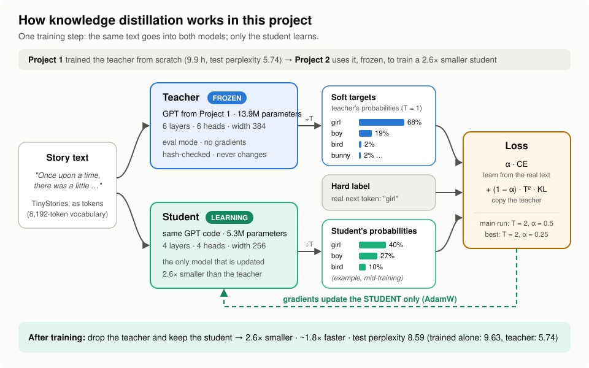
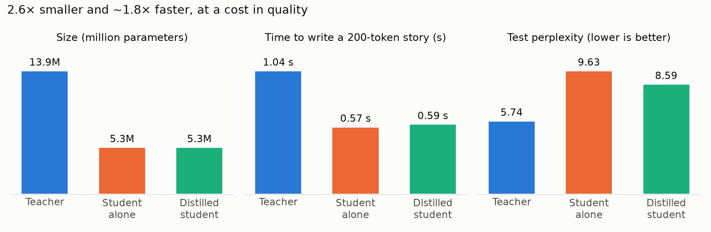
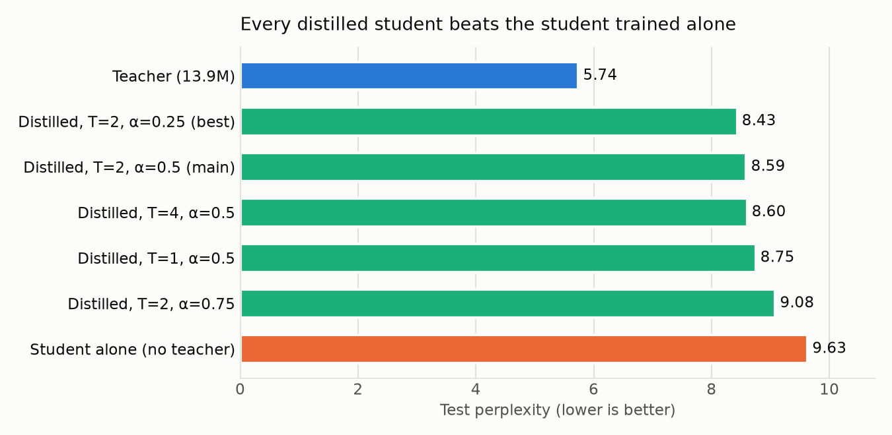
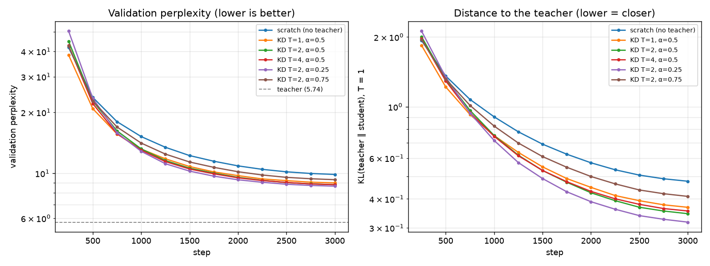
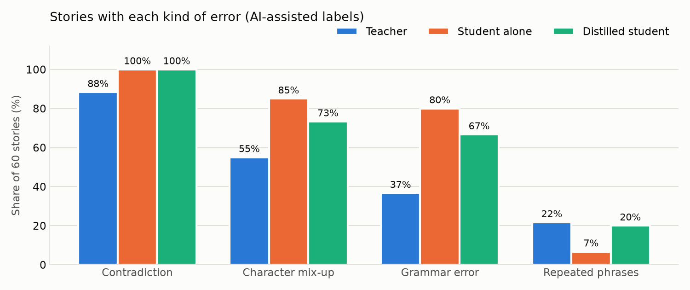

# Knowledge Distillation of a Small Language Model

**Can a small model learn to write stories by copying a bigger one?**

This project takes a 13.9-million-parameter story-writing model (the **teacher**, built in
[Project 1](https://github.com/istiaque010/Autoregressive-Transformer-Language-Model)) and trains a model
**2.6× smaller** (the **student**) to imitate it. This technique is called **knowledge distillation**.
Everything runs on a normal computer's **CPU**, with plain PyTorch.



> **Main question:** how much can the model be compressed through knowledge distillation while keeping its
> text-generation quality?

📘 **New to this?** Download [project2.html](project2.html) and open it in a browser: a step-by-step tutorial with
interactive figures. Every phase, with its commands and actual results, is in [INSTRUCTIONS.md](INSTRUCTIONS.md).

---

## Contents
1. [The idea in one minute](#1-the-idea-in-one-minute)
2. [Results at a glance](#2-results-at-a-glance)
3. [How it works](#3-how-it-works)
4. [Key terms](#4-key-terms)
5. [What is in this repository](#5-what-is-in-this-repository)
6. [How to run it](#6-how-to-run-it)
7. [All experiments](#7-all-experiments)
8. [What the small model loses](#8-what-the-small-model-loses)
9. [Limits](#9-limits)

---

## 1. The idea in one minute

A language model writes one word (token) at a time. At each step it gives a **probability to every possible next
word** and picks one.

The normal way to train a model is to show it real text: *"the next word was **girl**"*. That is one right answer, and
every other word counts as equally wrong.

A trained teacher knows more. After *"Once upon a time, there was a little…"* it thinks:

```
girl 68%   boy 19%   bird 2%   bunny 2%   dog 1%   …   refrigerator ≈ 0%
```

That full opinion tells the student that *boy* was also a good answer and *refrigerator* was not. In distillation,
the student learns to **match the teacher's whole opinion**, not just the one right answer, so every example teaches
it more.

> Like an apprentice learning from a master chef: tasting the master's dishes and copying the master's judgement is
> faster than learning from a recipe book alone.

After training, the teacher is no longer needed. Only the small, fast student is used.

---

## 2. Results at a glance

We trained the **same small model twice**: once on its own, and once with the teacher. Everything else was identical:
the data, the order of the data, the number of steps and the settings.

| | 🧑‍🏫 Teacher | 📖 Student alone | 🎓 Student with teacher (distilled) |
|---|---|---|---|
| Size (parameters) | 13.9M | 5.3M | 5.3M |
| File size | 53 MB | 20 MB | 20 MB |
| **Test perplexity** (lower = better) | **5.74** | **9.63** | **8.59** |
| Time to write a 200-token story (CPU) | 1.04 s | 0.57 s | 0.59 s |
| Stories with a grammar error | 37% | 80% | 67% |
| Stories with a character mix-up | 55% | 85% | 73% |
| Stories with a contradiction | 88% | 100% | 100% |
| Training time (CPU) | 9.9 h | 1.3 h | 2.0 h |



**The answer, in three points:**

1. ✅ **Smaller and faster:** the student is **2.6× smaller** and writes about **1.8× faster** than the teacher.
2. ✅ **Distillation helps:** the student trained with the teacher is clearly better than the one trained alone
   (8.59 vs 9.63). It closes **27% of the gap** to the teacher, or **31%** with the best setting found.
3. ❌ **But it is not as good as the teacher:** the biggest loss is **keeping a whole story consistent** (who is who,
   what is where). Every story from both small models contradicts itself somewhere, and distillation does not fix that.

**"Gap closed"** measures how far distillation moved the student toward the teacher:

```
gap closed = (student alone − distilled student) / (student alone − teacher)
           = (9.63 − 8.59) / (9.63 − 5.74) = 26.7%
```

The full table, generated from the saved results with no numbers typed by hand, is in
[results/final_comparison.md](results/final_comparison.md).

---

## 3. How it works

In every training step, the same text goes into both models. Only the student learns:

```
                   ┌─► Teacher (frozen, 13.9M) ─► teacher probabilities ─┐
story text ────────┤                                                     ├─► loss ─► update the STUDENT only
                   └─► Student (learning, 5.3M) ─► student probabilities ─┘
```

The **loss** mixes two goals ([kd/distillation.py](kd/distillation.py)):

```
loss = α · CE(student, real next word)  +  (1 − α) · T² · KL(teacher ‖ student)
        └── learn from the real text ──┘   └──────── copy the teacher ────────┘
```

- **α** decides the mix: `α = 1` means no teacher; `α = 0.5` is half and half; `α = 0.25` relies mostly on the teacher.
- **T** (temperature) softens both probability lists so the teacher's smaller probabilities become visible.
- **T²** keeps the "copy the teacher" part at the right strength whatever T is.

**Rules that keep the comparison fair:**
- The teacher is **frozen**: eval mode, no gradients, and its file is checked against Project 1's fingerprints before
  every run. Tests in [tests/](tests/) prove it, and fail if freezing is removed.
- Every student uses **one config** ([configs/student.yaml](configs/student.yaml)), the same seed (same data order),
  and the same 3,000 training steps. **Only the loss differs.**
- Scores use **Project 1's evaluation code and test set**. The teacher re-scores 5.7392, exactly as in Project 1.

---

## 4. Key terms

| Term | Meaning |
|---|---|
| **Teacher / student** | The big trained model that is copied / the small model that learns from it. |
| **Knowledge distillation** | Training the student to match the teacher's output probabilities. |
| **Token** | A word or piece of a word; the model knows 8,192 of them. |
| **Parameters** | The numbers inside a model that training adjusts (its "size"). |
| **Hard label / soft target** | The one real next word / the teacher's full probability list. |
| **Temperature (T)** | Flattens a probability list so small probabilities become visible (T = 1 is normal). |
| **α (alpha)** | How much weight the real text gets; 1 − α goes to copying the teacher. |
| **Cross-entropy (CE)** | The normal loss: how surprised the model is by the real next word. |
| **KL divergence** | How different two probability lists are; 0 = identical. Used as "distance to the teacher". |
| **Perplexity** | Roughly, how many words the model is choosing between at each step. Lower is better. |
| **Baseline** | The same student trained without the teacher: the score to beat. |
| **Ablation** | An experiment that changes one setting to see how much it matters. |
| **Frozen** | The teacher can't change and always gives the same answer. |

More terms, with pictures, are in the [tutorial](project2.html).

---

## 5. What is in this repository

```
kd/                      the distillation code
  teacher.py             load the teacher, check its fingerprint, freeze it
  model.py               build the student (the teacher's own GPT class, smaller)
  distillation.py        the distillation loss
  train_student.py       train a student (--mode scratch or kd)
  evaluate.py            test-set perplexity, closeness to the teacher, story writing
configs/                 student.yaml (all real runs), smoke.yaml (20-second test run)
scripts/                 one script per phase: checks, benchmarks, plots, comparisons, final table
  try_models.py          ▶ see the teacher and students write a story
  make_readme_figures.py the figures in this README, drawn from the saved results
tests/                   12 tests (teacher is frozen, loss is correct)
results/                 every measured result: scores, training logs, stories, error labels, figures
INSTRUCTIONS.md          all 14 phases: what to learn, commands, checks and actual results
project2.html            beginner tutorial with interactive figures
```

Not included (too large, rebuilt by the scripts): trained models (`checkpoints/`, 2.1 GB) and the Python environment.

---

## 6. How to run it

### What you need
- Python 3.12 and about **10 GB** of free disk space (mostly for Project 1's data and training files). A GPU is
  not needed.
- **Project 1's teacher and data.** This project reads them from a folder named `project1` next to it.

### Step 1: put Project 1 next to this project

The two folders must sit side by side and be named exactly `project1` and `project2`:

```
any-folder/
├── project1/     teacher/   data/full/      ← from Project 1 (read only)
└── project2/     this repository
```

```
git clone https://github.com/istiaque010/Autoregressive-Transformer-Language-Model.git project1
git clone https://github.com/istiaque010/Knowledge-Distillation.git project2
```

Project 1's git repository has the code but **not** its large files. Build them by following
[Project 1's README](https://github.com/istiaque010/Autoregressive-Transformer-Language-Model#readme):
1. **Data** (`project1/data/full/`): download, clean and tokenize TinyStories (~3 GB, Project 1 Phases 2–4).
2. **Teacher** (`project1/teacher/`): train the `small` model (~10 h on CPU), then run
   `python scripts/package_teacher.py` and check it with `python teacher/verify_teacher.py` (should print 5.74).

> The teacher package is not yet published as a download. Until it is, it has to be rebuilt as above.

### Step 2: set up Project 2 (Windows commands; on Linux/macOS use `source .venv/bin/activate` and `/`)

```
cd project2
python -m venv .venv
.venv\Scripts\activate
pip install torch==2.14.1 --index-url https://download.pytorch.org/whl/cpu
pip install -r requirements.txt
```

### Step 3: check that everything is in place (~3 minutes)

```
python -m pytest                      # should say: 12 passed
python scripts\check_teacher.py       # should say: all checks pass, test perplexity 5.74
```

### Step 4: watch distillation happen (20 seconds)

```
python -m kd.train_student --config configs\smoke.yaml --mode kd
```
You will see the loss go down as a tiny student learns from the teacher.

### Step 5: train the two main students (~1.3 h + ~2 h on a 24-thread CPU)

```
python -m kd.train_student --config configs\student.yaml --mode scratch                        # student alone
python -m kd.train_student --config configs\student.yaml --mode kd --temperature 2 --alpha 0.5  # with the teacher
```

### Step 6: score them on the test set (~4 minutes each)

```
python -m kd.evaluate --model teacher
python -m kd.evaluate --ckpt checkpoints\student_scratch\model_best.pt
python -m kd.evaluate --ckpt checkpoints\student_kd_T2_a0.5\model_best.pt
```

### Step 7: see them write

```
python scripts\try_models.py --prompt "Tom found a red box"
python scripts\try_models.py --interactive          # type your own story beginnings
```

Example output (same beginning, same random seed):
```
Teacher:             Tom found a red box in the attic. He was happy. He opened it and saw many papers and buttons…
Student alone:       Tom found a red box. It was pink and has a red car with a blue car on it…
Distilled student:   Tom found a red box in the kitchen. He was happy. "Wow, look at this box!" he said…
```

### Everything else
To run all the remaining experiments, evaluations and the speed test overnight:
```
powershell -ExecutionPolicy Bypass -File scripts\run_remaining.ps1
powershell -ExecutionPolicy Bypass -File scripts\run_alpha.ps1
python scripts\final_table.py --distilled student_kd_T2_a0.5 --ablation student_kd_T1_a0.5 --ablation student_kd_T4_a0.5 --ablation student_kd_T2_a0.25 --ablation student_kd_T2_a0.75
```

---

## 7. All experiments

Each row is the same student with one setting changed, trained for the same 3,000 steps (~2 h each):

| Run | Temperature T | α (real-text weight) | Test perplexity | Gap closed |
|---|---|---|---|---|
| Student alone | — | 1.0 | 9.63 | 0% |
| Distilled | 1 | 0.5 | 8.75 | 22.7% |
| **Distilled (main)** | **2** | **0.5** | **8.59** | **26.7%** |
| Distilled | 4 | 0.5 | 8.60 | 26.4% |
| Distilled | 2 | 0.75 | 9.08 | 14.1% |
| **Distilled (best)** | **2** | **0.25** | **8.43** | **30.7%** |
| *Teacher* | | | *5.74* | |

- **Every setting beats training alone.**
- **T = 2 and T = 4 work equally well**; T = 1 is weaker.
- **The more weight on the teacher, the better** (lower α).
- The main result uses T = 2, α = 0.5 because that was chosen **before** any run. The best setting found afterwards is
  reported separately, so the main claim is not cherry-picked.



The distilled student also reaches the "student alone" final score in about **37% fewer training steps**:



---

## 8. What the small model loses

We read 60 stories from each model and marked errors by hand, using Project 1's rules. The two students' stories were
mixed together and labelled **without knowing which model wrote which**
([scripts/error_labels/](scripts/error_labels/)).

| Error (share of stories) | Teacher | Student alone | Distilled student |
|---|---|---|---|
| Contradiction (e.g. a key turns into a necklace) | 88% | 100% | 100% |
| Character mix-up (e.g. "The cat thanked the cat") | 55% | 85% | 73% |
| Grammar (e.g. "a big box of key") | 37% | 80% | 67% |
| Repeated phrases | 22% | 7% | 20% |



- **Lost the most:** keeping a story consistent from start to end. Distillation doesn't recover it.
- **Helped a little:** grammar and character mix-ups. The direction is clear, but with 60 stories these two differences
  are not statistically significant.
- **Copied habits:** the distilled student repeats phrases as often as the teacher does. A student copies its
  teacher's flaws as well as its knowledge.

Stories side by side: [results/generations/comparison.md](results/generations/comparison.md).

---

## 9. Limits

- **Short training:** each student trained for 3,000 steps, only 30% of the teacher's training (chosen to fit a CPU
  budget). The curves were still improving, so longer training would raise every student.
- **One run per setting:** very small differences (like T = 2 vs T = 4) can't be told apart from noise.
- **Small hand-labelled sample:** 60 stories per model, labelled by one person.
- **CPU only, 32-bit:** the speed numbers are for one PC (Intel Core Ultra 7, 24 threads).

---

**Project series:** [Project 1: building the teacher from scratch](https://github.com/istiaque010/Autoregressive-Transformer-Language-Model) → **Project 2: knowledge distillation (this repository)**.
TinyStories is a third-party dataset with its own license. It is downloaded by Project 1's scripts and not
redistributed here.
